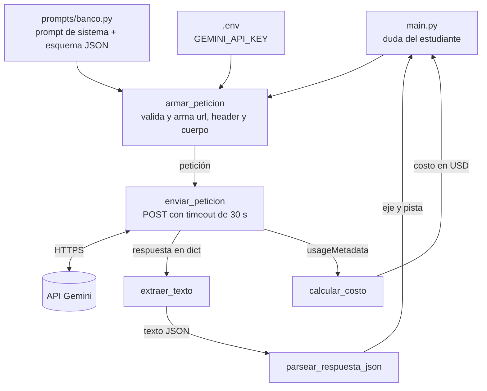

# Arquitectura de PM1

| Dónde | Qué error se maneja |
|---|---|
| `armar_peticion` | Pregunta vacía o falta la llave → `ValueError` |
| `enviar_peticion` | Sin conexión, timeout, HTTP ≠ 200, respuesta que no es JSON → `RuntimeError` |
| `extraer_texto` | La respuesta no trae texto → `RuntimeError` |
| `parsear_respuesta_json` | JSON inválido o faltan claves → `ValueError` |

`main.py` atrapa `ValueError` y `RuntimeError` y muestra un mensaje claro, sin traceback.
